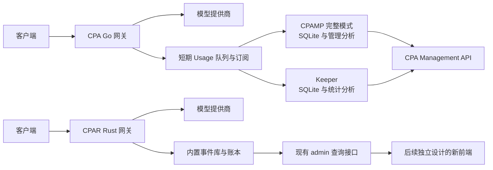

# CPAR 与 CPA、CPAMP、CPA Usage Keeper 差异调研

调研日期：2026-10-23。交付性质：源码与契约调研，不是部署、性能测试或产品验收。本轮只新增本报告，不调整业务代码、数据库、开发基线或既有产品决定。

## 1. 结论与建议

**CPAR 已经拥有网关、持久化请求记录、用量聚合、版本化价格和计费账本。下一步应补齐这些数据的查询与使用体验，参考 CPAMP 和 Keeper 的成熟功能，不需要重新建设统计底座。**

本次最重要的结论有七项：

1. **三类项目分工不同。** CPA 是流量网关；CPAMP 是管理与运维面板，完整模式附带统计服务；Keeper 是独立的持久统计、诊断和配额分析服务。它们的功能不能全部算作 CPA 内建能力。
2. **版本参考已经发生变化。** CPAR 最近移植使用 CPA v7.2.158；调研时 CPA 最新发布为 v8.0.40，Keeper 为 v2.0.1，CPAMP 为 v1.14.9。v8 管理 API、配置布局与事件字段需要单独对照，不能沿用旧接口印象。
3. **CPAR 已有很多可供新前端直接使用的接口。** 请求历史、请求趋势、P50/P95、首次内容延迟、七维用量分组、不可变价目表、账本、账号状态与配额读取都存在。旧 Prism 已退役，其历史截图和独立 Mock 原型不算当前产品界面。
4. **最明显的产品缺口在分析层。** 按 API Key 查看费用、Token/费用时间序列、配额历史、导出、长历史汇总与归档，以及调用方只读统计视图，尚未组成 CPAMP/Keeper 那样的完整工作流。
5. **直接接入现有面板，目前不成立。** CPAR 的 `/admin` 资源模型、认证与事件格式不同于 CPA；Keeper 和 CPAMP 固定依赖 CPA 的管理接口与队列。仅替换 URL 无法完成对接。
6. **统计“更宽容”不等于改变事实。** 请求参数兼容可以参考 CPA；未知 Token、重试次数、首内容时间和费用归属仍应清楚表达。CPA/衍生项目也存在丢失、重复计数或估算边界，不能作为可直接照抄的准确性保证。
7. **建议保留当前单进程 Rust 后端。** 在现有 control/store/HTTP 模块补充统计查询，新前端借鉴 CPAMP 的操作组织与 Keeper 的分析视图。若将来明确要运行原版 Keeper/CPAMP，再实现范围明确的对接适配；本报告不把它自动加入开发范围。

上述建议是本轮分析结论，没有替代现有 ADR。当前产品方向仍以 [后端架构](../03-target-architecture-draft.md) 和 [ADR-0124](../adr/ADR-0124-cpa-first-backend-and-frontend-retirement.md) 为准。

## 2. 项目身份、版本与证据范围

| 对象 | 本轮实际检查的源码 | 调研时最新发布 | 角色 |
|---|---|---|---|
| [CPA / CLIProxyAPI](https://github.com/router-for-me/CLIProxyAPI) | main `d946c4fba6fc9a5cfbca1f3d85184d62ad2fb683` | [v8.0.40](https://github.com/router-for-me/CLIProxyAPI/releases/tag/v8.0.40) | Go 网关、协议/Provider 执行、凭据与用量事件输出 |
| [CPAMP / CPA-Manager-Plus](https://github.com/seakee/CPA-Manager-Plus) | main `794ef828023960ccad0a2e9848293aee0880d688` | [v1.14.9](https://github.com/seakee/CPA-Manager-Plus/releases/tag/v1.14.9) | 轻量管理 UI；或 Go Manager Server + SQLite + UI 的完整模式 |
| [CPA Usage Keeper](https://github.com/Willxup/cpa-usage-keeper) | main `5604768d352a1a85dd5c087b4e85bd657a159a02` | [v2.0.1](https://github.com/Willxup/cpa-usage-keeper/releases/tag/v2.0.1) | Go + SQLite + React 的独立采集分析服务 |
| [官方 Management Center / CPAMC](https://github.com/router-for-me/Cli-Proxy-API-Management-Center) | main `714de0760a3ce86094b178fb46f834d34bc4a2a5` | [v1.26.7](https://github.com/router-for-me/Cli-Proxy-API-Management-Center/releases/tag/v1.26.7) | CPA 托管的单 HTML 管理 UI，不是独立统计数据库 |
| CPAR | `feature/62-client-metadata`，HEAD `ab78c65ca68978bf46c7cf530ea795417d8431f3` **加本地未提交修改** | 本轮不评估发布版本 | Rust 网关与持久化控制、统计后台；当前无旧管理前端 |

“最新发布”是 GitHub API 返回的 release 元数据；实际源码审阅固定到上表 main SHA，**不假定 main 与 release tag 完全相同**。源快照获取于 2026-10-23 14:25 UTC 左右，记录了 archive SHA-256。CPAR 保留当前架构整理和请求兼容改动，不能仅用 HEAD 描述本轮检查的完整内容。

参考副本与元数据保存在工作区外层 `maintenance/2026-10-23-cpa-ecosystem-research/`；`baseline.json` 记录调研开始时 7,490 个 tracked/untracked 路径及其内容、权限或链接状态。它不是生产数据备份。本轮未读取生产数据库、凭据或私有请求内容。

证据分为：**源码确认**、**由源码推断**、**未运行验证**。下文“已有”表示接口与实现存在，不表示真实 Provider、浏览器、线上部署或负载验收已通过。对缺失能力的判断限定在所列源码、路由和契约检索范围。

## 3. 职责关系与功能概览

CPAMP 的轻量模式只替换 CPA UI，不提供 SQLite 历史、成本分析和服务端巡检；完整模式才有这些能力。官方 CPAMC 当前直接依赖 `/v8/management`，README 明确没有 v0 fallback。Keeper 不承接模型推理，而从 CPA 读取事件、配置和凭据状态。来源：[CPAMP 能力矩阵](https://github.com/seakee/CPA-Manager-Plus/blob/794ef828023960ccad0a2e9848293aee0880d688/apps/docs/reference/capability-matrix.md)、[CPAMC 运行要求](https://github.com/router-for-me/Cli-Proxy-API-Management-Center/blob/714de0760a3ce86094b178fb46f834d34bc4a2a5/README.md#one-place-to-manage-your-instance)、[Keeper README](https://github.com/Willxup/cpa-usage-keeper/blob/5604768d352a1a85dd5c087b4e85bd657a159a02/README.md#features)。

| 能力 | CPA 本体 | CPAMP 完整模式 | Keeper | 当前 CPAR |
|---|---|---|---|---|
| 模型请求转发 | 核心职责 | 依赖 CPA | 依赖 CPA | 核心职责 |
| 管理配置、OAuth、凭据 | 原生管理 API | 完整管理工作流 | 同步元数据，部分凭据操作 | 已有 API、版本发布与运行态投影 |
| 长期请求明细 | 本轮未发现内建长期 Usage DB | SQLite | SQLite | 内置 SQLite 事件库 |
| 请求与执行次数分开 | 事件含执行及关联标识 | 以采集事件为主，另有近似任务统计 | 事件计数为主 | Request 与 Attempt 显式分离 |
| 维度统计与趋势 | 向外提供事件 | 较完整 | 较完整 | 请求趋势、用量分组已有；Token/费用趋势欠缺 |
| 价格与成本 | 本轮未发现 token 定价器 | 当前价格估算，历史可变化 | 入库估算，显式有限窗口重算 | 不可变价格版本与幂等 ledger |
| 账号/模型/调用方成本分析 | 外部完成 | 已有 | 已有 | billing 与 usage 维度未完全贯通 |
| 首内容/延迟分析 | 输出 latency/ttft 等事件字段 | 平均值与 P95，取决于采集数据 | 实时诊断、P95、速度分析 | 总耗时 P50/P95、平均首次内容延迟已有 |
| 配额当前值 | Provider 特定信息 | 已有 | 已有 | 已有，支持范围依渠道 |
| 配额历史与效率 | 外部完成 | 配额快照、巡检历史 | Codex/Claude 周期历史与消耗分析 | 当前快照为主，未发现连续历史查询 |
| 账号巡检自动化 | 原生刷新/调度 | Codex/xAI 巡检、冷却与处理队列 | 配额采集及部分管理操作 | 刷新、冷却、显式恢复已有；完整巡检工作流欠缺 |
| 数据导出与归档 | 短期事件输出 | JSONL、分段归档及覆盖检查 | CSV/JSON、冷热表及聚合 | 加密备份已有；统计导出、自动归档欠缺 |
| 调用方只读统计门户 | 外部完成 | 本轮不评估独立 Key viewer | 服务端绑定 API Key 的 viewer | 未发现对应产品接口 |
| 当前可用管理 UI | 配套官方 UI | 有 | 有 | 旧 UI 已按决定移除，新 UI 待开发 |

网关范围也仍有差异：CPA 当前路由还覆盖 Gemini `/v1beta` 与图片/视频等入口；CPAR 公开接口集中在 Chat、Responses、Messages 和 Responses 存储/续轮/WebSocket。CPAR 的当前 adapter 注册表覆盖通用 OpenAI/Anthropic、Grok 多种接入和 Kiro；这不等于已经移植全部 CPA v8 Provider。统计报告不替代这些渠道的专项对照。证据：[CPA 路由](https://github.com/router-for-me/CLIProxyAPI/blob/d946c4fba6fc9a5cfbca1f3d85184d62ad2fb683/internal/api/server_routes.go)、[CPAR adapter 注册](../../apps/gateway/src/runtime.rs#L574)、[CPAR 公共 API](../../README.zh-CN.md#公共-api)。

## 4. 数据从哪里来，哪些情况下会丢失或重复

### 4.1 CPA 输出是短期队列，不是外部统计的持久日志

源码显示，CPA 的 Usage 首先经 SDK 派发，再进入进程内队列或 RESP 订阅：

- HTTP `/v8/management/observability/usage/queue?count=N` 与旧 `/v0/management/usage-queue` 都是 **pop**：响应写出之前已从队列移除。
- RESP 在 CPA 端口上复用连接，不要求另装 Redis 数据库；支持 AUTH、SUBSCRIBE、LPOP/RPOP 等。其订阅确认不是逐事件持久化 ACK。
- 没有订阅者时，事件进入内存队列；保留时间默认 60 秒、最大 3,600 秒。
- 有订阅者时广播并跳过该积压队列；每个订阅者缓冲 256 条，满时关闭该订阅者，当前事件不自动回存。
- 订阅没有历史重放/持久 offset 协议；进程重启也不能依靠内存队列恢复历史。

因此，**同时运行 CPAMP 和 Keeper 时应使用订阅方式避免互相 pop，但订阅也不提供完整补发保证**。如果一个消费者保持在线，另一个离线，离线者重连后不能假定收到全部遗漏。`config.example.yaml` 有关闭本地 RESP 输出的文字，但当前 multiplexer/handler 仍有可达实现；本轮只确认代码，未验证实际部署模式。来源：[queue.go](https://github.com/router-for-me/CLIProxyAPI/blob/d946c4fba6fc9a5cfbca1f3d85184d62ad2fb683/internal/redisqueue/queue.go#L9)、[HTTP pop handler](https://github.com/router-for-me/CLIProxyAPI/blob/d946c4fba6fc9a5cfbca1f3d85184d62ad2fb683/internal/api/handlers/management/usage.go#L23)、[RESP handler](https://github.com/router-for-me/CLIProxyAPI/blob/d946c4fba6fc9a5cfbca1f3d85184d62ad2fb683/internal/api/redis_queue_protocol.go#L108)。

### 4.2 两个衍生项目的恢复和去重策略不同

| 项目 | 采集选择 | 本地处理与去重 | 保留的限制 |
|---|---|---|---|
| CPAMP | auto：订阅 → HTTP → RESP；曾订阅成功后断线持续重连 | 联合字段 hash + 持久身份账本；事务写 raw 与 identity；无效事件进 dead letter | 不是仅按 execution ID 去重；先 pop 后入库仍有丢失窗口 |
| Keeper | 初始：订阅 → RESP LPOP → HTTP；重连可补拉当时队列 | 先保存 inbox，再同事务写 usage 与处理状态 | **明确不对重复 request/event/execution 去重**；同一 inbox 重试保护不等于跨投递去重 |
| CPAR | 自己产生 Request/Attempt/Usage，由内部 writer 确认落盘 | 事件身份唯一、相同重放幂等、冲突隔离；ledger 按 source event 幂等 | 有界存储故障会影响请求准入；不能把尚未确认的记录当持久成功 |

Keeper 当前要求 `execution_id`，缺失会解码失败；因此只输出旧版 CPA 形状，即使路径匹配，也不能保证 Keeper v2 接受。CPAMP 的 hash 包含时间、模型、账号、Token、失败与部分延迟字段，字段变化可能产生另一条记录。来源：[CPAMP collector](https://github.com/seakee/CPA-Manager-Plus/blob/794ef828023960ccad0a2e9848293aee0880d688/apps/manager-server/internal/collector/collector.go#L140)、[CPAMP event hash](https://github.com/seakee/CPA-Manager-Plus/blob/794ef828023960ccad0a2e9848293aee0880d688/apps/manager-server/internal/usage/event.go#L1326)、[Keeper 入库策略](https://github.com/Willxup/cpa-usage-keeper/blob/5604768d352a1a85dd5c087b4e85bd657a159a02/internal/repository/db.go#L345)、[Keeper execution 校验](https://github.com/Willxup/cpa-usage-keeper/blob/5604768d352a1a85dd5c087b4e85bd657a159a02/internal/service/redis_usage.go#L25)、[CPAR writer 的现行修订](../adr/ADR-0027-append-only-bounded-sqlite-event-writer.md#amendment-2026-09-26-reliability-m1)。

**对 CPAR 的意义：** 可以借鉴采集与展示格式，但内部数据库应继续作为事实来源，不必为追随外部面板改成消费即删除的唯一事件源。未来若做兼容导出，需要明确事件身份、每个消费者的进度、重复和重连规则；尤其不能把“可重放”与“不去重的下游”直接拼接。

## 5. 请求数、Token、失败与延迟不能只比字段名

### 5.1 一次客户端请求可能对应多次上游执行

CPA `usage.Record` 描述一次 provider request，reporter 使用独立 UUID；队列 `request_id`、`execution_id`、`trace_id` 分别承担不同关联作用。重试及部分额外模型执行可产生多条事件。CPAMP 的近似任务统计也不是客户端任务完成率；Keeper overview 按事件递增 request count。

CPAR 已显式区分 Request、Attempt、Usage。同组中的同一 Request 可以有多个 `usage_observations`，而 `request_count` 只计一次。按账号分组后，同一个跨账号重试的请求可分别出现在多个组，因此分组请求数也不能无条件相加当作全局独立请求数。这是从分组实现得出的推断。来源：[CPA record 与标识](https://github.com/router-for-me/CLIProxyAPI/blob/d946c4fba6fc9a5cfbca1f3d85184d62ad2fb683/sdk/cliproxy/usage/manager.go#L24)、[Keeper overview 累计](https://github.com/Willxup/cpa-usage-keeper/blob/5604768d352a1a85dd5c087b4e85bd657a159a02/internal/overview/aggregate.go#L145)、[CPAR 分组去重](../../crates/gateway-control/src/management_operations_service.rs#L1423)。

### 5.2 缓存与 reasoning 可能已包含在总量里

CPA Accounting v2 把输入分成 uncached/read/write，输出分成非 reasoning/reasoning，并报告 complete/inconsistent/unclassified。这套机制在 v7.2.158 已有，不应误列为 v8 新增。不同协议的 input/output 包含关系不同，不能把所有 Token 字段相加。

CPAMP 按缓存包含关系归一化；Keeper 按 executor 类型处理 Claude/Gemini/Codex 等差异；CPAR 保留六类可空 Token、provenance 和 input accounting，定价时避免重复计费。值得借鉴的是明确的口径和缓存分项视图，而不是把各协议原字段简单堆在图表上。来源：[CPA accounting](https://github.com/router-for-me/CLIProxyAPI/blob/d946c4fba6fc9a5cfbca1f3d85184d62ad2fb683/sdk/cliproxy/usage/accounting.go)、[Keeper token processor](https://github.com/Willxup/cpa-usage-keeper/blob/5604768d352a1a85dd5c087b4e85bd657a159a02/internal/service/tokenprocessor/resolver.go)、[CPAR 定价计算](../../crates/gateway-control/src/billing_service.rs)。

### 5.3 未知不等于零，失败也可能消耗 Token

CPA `EnsurePublished` 在上游没提供 Usage 时可发布空 Detail，保证事件计数；零值及 complete 不能证明 Provider 明确报告零。不同 executor 的失败保留也不完全一致：部分路径保留已见 Usage，另一些 scanner error 只发布空失败记录。

CPAR 当前已将明确关联的失败 Attempt Usage 分配给实际失败账号并生成相应 ledger；成功 fallback 不吞并前次用量。没有 `attempt_id` 的旧历史才沿用较早的成功 Attempt 归属规则。新前端应展示已知消费、缺失项和完整性，不能因为请求失败就把成本归零。来源：[CPA Usage 发布](https://github.com/router-for-me/CLIProxyAPI/blob/d946c4fba6fc9a5cfbca1f3d85184d62ad2fb683/internal/runtime/executor/helps/usage_helpers.go#L543)、[OpenAI-compatible 失败路径](https://github.com/router-for-me/CLIProxyAPI/blob/d946c4fba6fc9a5cfbca1f3d85184d62ad2fb683/internal/runtime/executor/openai_compat_executor.go#L477)、[CPAR 失败用量归属](../adr/ADR-0103-failed-bootstrap-usage-attribution.md)、[现有回归断言](../../apps/gateway/src/runtime/batch_c/http/bootstrap_usage.rs#L293)。

### 5.4 TTFT、首次内容、速度和百分位各有口径

| 指标 | 当前事实 | 对齐注意点 |
|---|---|---|
| CPAR `first_content_ms` | 服务端首次编码内容交接；JSON 等完整 JSON 交付；文本、reasoning、工具事件均可触发 | 不能直接命名为客户端观察到的 TTFT |
| CPAR latency P50/P95 | 请求终态耗时、nearest-rank；请求趋势按完成时间分桶 | 已有，无需重做；未知终态和取消需单列 |
| CPAMP P95 | 基于采集到的正值 latency/TTFT 样本 | 无观测时不代表零延迟，也不是它自行测量客户端 |
| Keeper P95 | 实时窗口精确排序；长期分析使用对数桶近似 | 同叫 P95，算法精度与样本范围不同 |
| Keeper token/s | 输出 Token / 总耗时，另有输出 Token /（总耗时−TTFT） | 后者不是标准逐 Token 间隔 TPOT 的简单倒数 |

CPAR 请求 summary 的成功率排除 unknown，但包含 cancelled 作为分母；`include_unknown` 查询中没有终态的记录也不能按完成时间窗口解释。统计页面需要统一选择范围，而不能只对齐卡片名称。来源：[CPAR 请求观察](../../crates/gateway-http-actix/src/request_observation.rs#L41)、[CPAR 历史统计](../../crates/gateway-store/src/control_plane/request_history.rs#L124)、[Keeper latency sketch](https://github.com/Willxup/cpa-usage-keeper/blob/5604768d352a1a85dd5c087b4e85bd657a159a02/internal/latency/sketch.go#L13)、[Keeper 速度计算](https://github.com/Willxup/cpa-usage-keeper/blob/5604768d352a1a85dd5c087b4e85bd657a159a02/internal/overview/aggregate.go#L72)。

## 6. 成本分析：三种历史价格政策

| 项目 | 价格来源与计算 | 历史发生什么变化 | 主要限制 |
|---|---|---|---|
| CPAMP | models.dev → LiteLLM → OpenRouter，加手工覆盖；缓存、service tier、上下文阶梯与别名处理 | 查询使用当前价格，历史估算可随改价变化；有投影/结构覆盖检查 | 某些无匹配价格路径返回 0，不能当作免费；部分倍率有兼容兜底 |
| Keeper | 入库批次绑定价格快照，保存 `cost_usd/cost_available`；倍率和缓存分价 | 改价不自动重估历史；可显式重算最近 30×24 小时与热表的交集 | 重算任务是进程内状态；崩溃后已提交批次保留，需重新发起；不是不可变账单 |
| CPAR | Provider/Channel/public-model 精确价目版本，整数微单位，绑定源 Usage 的 ledger | 新价目追加版本，不覆盖既有 ledger；回滚也创建新版本 | 复杂阶梯/tier价格尚未覆盖；缺价历史不会自动补价重算 |

CPAR 的 `exact` 描述已报告用量和本地价格规则下的计算完整性，不表示已经与 Provider 发票核对。所有项目都应区分本地估算/计算金额与实际账单。来源：[CPAMP 价格来源](https://github.com/seakee/CPA-Manager-Plus/blob/794ef828023960ccad0a2e9848293aee0880d688/apps/manager-server/internal/httpapi/server.go#L20)、[CPAMP cost](https://github.com/seakee/CPA-Manager-Plus/blob/794ef828023960ccad0a2e9848293aee0880d688/apps/manager-server/internal/service/pricing/cost.go#L149)、[Keeper 重算](https://github.com/Willxup/cpa-usage-keeper/blob/5604768d352a1a85dd5c087b4e85bd657a159a02/internal/service/pricing_recalculation.go#L124)、[CPAR 价格管理决定](../adr/ADR-0080-protected-billing-catalog-management.md)。

**当前 CPAR 的实际断点是两套查询尚未完全接通：**

- `/admin/operations/usage` 已按 Provider、渠道、账号、模型、协议、Client Key、Access Group 分组，但返回的 `cost_microunits` 仍固定为 null/unpriced。
- `/admin/operations/billing` 已有真实 ledger 金额和完整性状态，但缺少按 Client Key、Access Group、协议筛选/分组的对应分析能力。
- `/admin/billing/price-source/refresh` 已能获取 models.dev 报价；它是供审阅的读取接口，**不会自动写入价目表**，遇到阶梯价格返回不可平铺的状态。

因此，“再写一个计费系统”没有必要；优先把现有用量身份、账本费用与时间聚合贯通。若需要“按今天价格估算历史”，可以作为独立分析视图提出，不应默认覆盖既有 ledger。来源：[Usage 输出](../../crates/gateway-control/src/management_operations_service.rs#L1453)、[Billing 读取](../../crates/gateway-store/src/billing_ledger.rs#L720)、[价格来源接口](../../crates/gateway-http-actix/src/management_resources/price_source.rs#L16)。

## 7. 配额、账号健康与自动化

CPAR 不是缺少账号管理：当前有凭据 metadata、native account usage、runtime availability、provider account pools、刷新、冷却和显式恢复。普通账号配额使用进程内缓存；Grok 有持久化的当前窗口快照，但会替换旧窗口。**这些是当前状态，不是可连续查询的配额历史。** 来源：[普通账号查询](../../apps/gateway/src/runtime/account_quota.rs)、[Grok usage 查询](../../apps/gateway/src/native_account_usage.rs)、[窗口持久化](../../crates/provider-grok/src/runtime_state.rs#L566)。

Keeper 更值得借鉴的增量是：Codex primary/secondary、Claude five_hour/seven_day 周期历史；将窗口下降量与已采集 Token/成本关联；清楚区分重置、校准和普通变化。但其历史属于低优先级采样，队列有界、失败允许缺口，关联数据也受热表保留期限制。它并不是精确的 Provider 额度账本。来源：[Keeper 配额历史](https://github.com/Willxup/cpa-usage-keeper/blob/5604768d352a1a85dd5c087b4e85bd657a159a02/internal/quota/codex_quota_history.go#L13)、[历史调度与写入](https://github.com/Willxup/cpa-usage-keeper/blob/5604768d352a1a85dd5c087b4e85bd657a159a02/internal/quota/codex_quota_history_runner.go#L15)。

CPAMP 更值得借鉴的是账号工作流：Codex/xAI 定时巡检、被动失败处理队列、配额冷却、恢复前身份核对和自动化操作所有权。其默认关闭巡检/自动动作，且原本手动禁用的账号不会被别的自动化随意恢复。不能把支持多类 quota snapshot 误写成所有 Provider 都有同等主动巡检能力。来源：[巡检配置](https://github.com/seakee/CPA-Manager-Plus/blob/794ef828023960ccad0a2e9848293aee0880d688/apps/manager-server/internal/model/codex_inspection.go#L38)、[冷却与恢复](https://github.com/seakee/CPA-Manager-Plus/blob/794ef828023960ccad0a2e9848293aee0880d688/apps/manager-server/internal/worker/rate_limit_auto_disable.go#L317)。

建议顺序：先补只读配额历史，再完善显式巡检与处理流程。CPAR 当前“解除本地阻断”仍不等于 Provider 恢复，也不应在新页面写成“账号已正常”。这一边界与 [CONTEXT](../../CONTEXT.md) 一致。

## 8. 长历史、归档、导出和备份

| 项目 | 热数据与聚合 | 归档/清理 | 不能混淆的边界 |
|---|---|---|---|
| CPAMP | 增量小时汇总与原始查询结合；复杂过滤依赖 raw | `.jsonl.gz` 分段、manifest/hash、身份账本；删除前验证聚合和投影覆盖；自动保留默认关闭 | JSONL export 只导出当前 raw，不自动拼回 archive；删除 raw 后不是所有过滤/百分位都还可查询 |
| Keeper | overview/activity/latency 独立 checkpoint；小时/日汇总 | 超过90个本地自然日转冷表；archive 默认永久保留，可配置删除；默认定期备份 | 普通页面不直接读冷表；不同聚合另有期限；原始 archive 留存不等于所有图表无限历史 |
| CPAR | 请求终态覆盖索引、快照分页、Usage 访问器、ledger 查询 | event log 禁止 DELETE；生产 billing worker 未启用 ledger retention；未发现小时/日 rollup 与归档工作流 | 不是“所有查询都把全库装进内存”，但长窗口仍可能扫描大量匹配记录；容量未实测 |

CPAR 已有加密 SQLite 备份/空目标恢复，不能说完全没有备份。但当前完整加密 artifact 上限 **16 MiB**，且没有通用的请求 CSV/JSONL 导出接口。对于持续增长的统计库，这是需要验证和完善的具体限制。密文恢复仍需要独立 Master Key，凭据格式导出也不等于统计导出。来源：[CPAMP archive 删除验证](https://github.com/seakee/CPA-Manager-Plus/blob/794ef828023960ccad0a2e9848293aee0880d688/apps/manager-server/internal/service/usage/archive.go#L1019)、[Keeper 冷热表事务](https://github.com/Willxup/cpa-usage-keeper/blob/5604768d352a1a85dd5c087b4e85bd657a159a02/internal/repository/usage_event_archive.go#L46)、[CPAR append-only 触发器](../../crates/gateway-store/migrations/0027_request_terminal.up.sql#L25)、[CPAR 备份上限](../../crates/gateway-store/src/backup.rs#L29)。

这里应借鉴两者的 checkpoint、覆盖声明和先归档再清理流程，不应立即为 CPAR 引入第二套统计数据库。事件清理会涉及当前 append-only 决定，若实施，需要专门修改持久化契约和验证恢复链，本调研没有执行该变更。

## 9. 为什么现有面板不能直接连接 CPAR

| 对接面 | 当前上游生态要求 | CPAR 当前情况 |
|---|---|---|
| 管理路径 | CPAMC/Keeper 主用 `/v8/management`；CPAMP 仍使用 v0 并适配 v8 配置形状 | `/admin`，版本化资源及不同响应 schema |
| 认证 | CPA Management Key/Bearer；订阅同 Key AUTH | Management Key/管理员 session，独立监听器及 CSRF；推理 Key 不等同管理权限 |
| 事件源 | HTTP queue 或 RESP subscribe/pop | 内部事件 writer；没有外部 CPA queue/RESP API |
| 事件身份 | execution/request/trace、auth_index、executor、source 等 | Request/Attempt/Usage 与非秘密资源 ID；需要显式字段映射 |
| 账号与配额 | credentials/config/api-call/cooldown 等 CPA 契约 | credentials/native-accounts/runtime/provider-pool 等已有专用 API |
| 调用方统计 | Keeper 同步 active Key，服务端绑定 viewer 范围 | 管理者可按 Key ID 筛选；未提供 Key-scoped viewer 权限 |

来源：[Keeper 固定 endpoints](https://github.com/Willxup/cpa-usage-keeper/blob/5604768d352a1a85dd5c087b4e85bd657a159a02/internal/cpa/endpoints.go)、[CPAMP 验证接口](https://github.com/seakee/CPA-Manager-Plus/blob/794ef828023960ccad0a2e9848293aee0880d688/apps/manager-server/internal/service/cpa/client.go#L26)、[CPA v8 配置规则](https://github.com/router-for-me/CLIProxyAPI/blob/d946c4fba6fc9a5cfbca1f3d85184d62ad2fb683/docs/management-api-v8.md#configuration-endpoints)、[CPAR 管理认证](../../crates/gateway-http-actix/src/management_security.rs#L296)。

还应注意两点：

- Keeper 已保存 session/parent/trace/fork/compaction 字段，但本轮没发现这些字段在普通事件 API/导出中形成完整会话树查询；不能仅凭实体字段就把“会话分析已完成”计入差距。CPAR 的私密 Codex 元数据留存同样不等于已有会话统计页面。
- Keeper 的 Key viewer 是后端权限限制，不是隐藏前端按钮。它还依赖本地同步的完整客户端 Key；CPAR 不应为了仿造这一工作流而扩大秘密暴露。若实施 viewer，应复用现有认证，按当前 principal 固定范围。

证据：[Keeper viewer 路由](https://github.com/Willxup/cpa-usage-keeper/blob/5604768d352a1a85dd5c087b4e85bd657a159a02/internal/api/router.go#L155)、[Keeper事件 DTO](https://github.com/Willxup/cpa-usage-keeper/blob/5604768d352a1a85dd5c087b4e85bd657a159a02/internal/service/dto/usage.go)、[CPAR 请求元数据](../../crates/gateway-core/src/request_metadata.rs#L146)。

## 10. 新前端现在可以直接使用什么

以下是已存在的后端入口，路径与字段以 [management-v1 OpenAPI](../openapi/management-v1.json) 为准。

| 用户任务 | 现有 API | 尚需补齐 |
|---|---|---|
| 看最近请求、失败与耗时 | `GET /admin/requests`、`GET /admin/requests/summary` | 新页面、筛选联动；更细错误与会话维度按需求增加 |
| 排查一次请求的重试 | `GET /admin/requests/{request_id}/attempts` | 将 Request 与各 Attempt 的归属清楚呈现 |
| 按账号/模型/Key 看用量 | `GET /admin/operations/usage` | Token时间序列、排行与费用贯通 |
| 查账本与费用完整性 | `GET /admin/operations/billing` | Key/Group/协议维度和统一成本趋势 |
| 判断统计是否处理完 | `GET /admin/operations/billing-processing` | 在页面呈现水位、失败/修复状态 |
| 管理价格 | `/admin/billing/catalogs`、`/admin/billing/price-source/refresh` | 报价预览、确认导入、缺价提示；不是重写ledger |
| 看凭据当前额度 | `GET /admin/credentials/{credential_id}/metadata` | 配额历史和统一窗口显示 |
| 看 Grok 原生账号用量 | `GET /admin/native-accounts/{account_id}/usage` | 保留观察来源/时间/partial，不补假余额 |
| 看账号池和可用性 | `/admin/operations/provider-account-pools`、`/admin/runtime/availability` | 状态与请求明细联动、巡检流程 |
| 看系统运行指标 | `GET /admin/observability/metrics` | 运维展示/采集集成；生产 OTel 仍为 Noop exporter |

这些接口已有对应 Store/Control/HTTP 实现。本轮定位了 `crates/gateway-store/tests/request_history.rs`、`crates/gateway-http-actix/tests/managed_resource_inventory.rs`、`p12_observability_metrics.rs`、billing materializer/service 单测等，但没有重跑运行时测试。前一轮兼容性 Gate 仍是前一轮证据，不作为本次调研的新验收。

## 11. 建议的对齐顺序与最小交付

下面是建议的开发切片，不是本轮已实施或已承诺排期。优先使用现有模块，只有明确的接口需求再增加文件或类型。

| 顺序 | 交付内容 | 主要参考 | 完成时应能回答的问题 |
|---|---|---|---|
| 1 | 贯通 Request/Usage/ledger 的统一分析：先支持时间、模型、账号、Client Key 费用/Token趋势 | CPAMP 的筛选联动、Keeper 的 overview；复用 CPAR ledger | 某个Key本周消耗多少、费用中多少已定价、失败重试消耗属于谁？ |
| 2 | 价格获取 → 审阅 → 创建版本 → 缺价说明；补充明确需要的tier/阶梯规则 | CPAMP 定价来源与模型别名，Keeper 不可用费用计数 | 为什么费用为空或只有部分？采用哪版价格？换价是否影响历史？ |
| 3 | 稳定快照的请求/用量 CSV 或 JSONL 导出 | CPAMP snapshot export、Keeper导出 | 同一过滤条件的页面和导出是否对应同一批记录？未知值是否保留？ |
| 4 | 当前配额的定时历史记录与查询 | Keeper quota cycles、CPAMP 状态证据 | 额度何时下降/重置，哪个窗口、来源和采样缺口是什么？ |
| 5 | 按实际数据量增加小时/日汇总、保留策略与可恢复归档；完善大库备份 | 两者 checkpoint 与覆盖验证 | 查一年趋势是否可控，归档后哪些明细仍可查，能否恢复？ |
| 6 | 用上述接口构建新的管理与统计前端 | CPAMP 管理流程 + Keeper分析视图 | 管理者能否从总览定位到具体调用方、账号和失败尝试？ |
| 按需 | API-Key只读viewer、明确的账号巡检/处理队列 | Keeper权限范围、CPAMP自动化所有权 | 调用方是否只能看到自身数据；自动化是否只恢复自己禁用的账号？ |
| 目标明确后 | 原版 CPAMP/Keeper 对接适配 | 固定版本的双方接口 | 除了接通，重连、重复、缺字段和多个消费者是否也有定义？ |

第一项不需要建立通用查询语言或另一个统计服务：在现有 `gateway-store` 中提供聚合读模型，`gateway-control` 组合用量与费用，现有 management HTTP 暴露有界查询即可。先用现有数据验证一条完整分析流程，再按实际容量决定是否提前实现 rollup。

以下现有成果应保留：Request/Attempt/Usage 身份、错误请求的已知用量、未知/部分/缺价区分、版本价格与幂等ledger、现有管理权限与账号隔离。可以直接借鉴并重实现的是图表指标、筛选交互、定价来源读取、配额窗口展示、导出及归档流程。

CPA、CPAMP、Keeper 和官方 CPAMC 的本次源码均带 MIT 许可证；后续移植源代码或重要片段应保留相应声明。具体原文见各固定版本的 [CPA LICENSE](https://github.com/router-for-me/CLIProxyAPI/blob/d946c4fba6fc9a5cfbca1f3d85184d62ad2fb683/LICENSE)、[CPAMP LICENSE](https://github.com/seakee/CPA-Manager-Plus/blob/794ef828023960ccad0a2e9848293aee0880d688/LICENSE)、[Keeper LICENSE](https://github.com/Willxup/cpa-usage-keeper/blob/5604768d352a1a85dd5c087b4e85bd657a159a02/LICENSE)、[CPAMC LICENSE](https://github.com/router-for-me/Cli-Proxy-API-Management-Center/blob/714de0760a3ce86094b178fb46f834d34bc4a2a5/LICENSE)。本轮没有移植其代码。

## 12. 验证边界与可复查入口

本轮完成：官方仓库身份和发布元数据查询、四个固定 SHA 的只读源码快照、CPAR 当前源码/契约核查、关键结论的定点复核、调研文档产出。报告提交前使用仓库文档检查和工作树保存核对。

本轮未执行：上游项目构建/测试、实际 CPA+CPAMP+Keeper 多消费者联调、浏览器视觉验收、真实 Provider 调用、生产数据迁移、负载测试、部署或发布。文中性能、重复或丢失判断来自实现机制；没有将其写成已测得的错误率或吞吐量。

未发现能力的主要检索范围：CPAR `apps/gateway/src`、`crates`、SQLite migrations、management handlers 与完整 OpenAPI；CPA `internal/sdk/cmd` 中采集、管理和持久化实现；CPAMP Manager Server 的 collector/repository/service/worker；Keeper 的 poller/repository/service/api/quota。未审计任意外置插件、第三方分支或线上私有配置。

应继续单独确认的事实：CPA 当前 RESP 在目标部署模式的可用性；真实多消费者断线行为；CPAR 大历史查询和超过16 MiB备份的实际边界；原版面板对适配器的完整请求集合。它们不会改变“CPAR已有统计底座、优先补分析与管理工作流”的当前判断。
